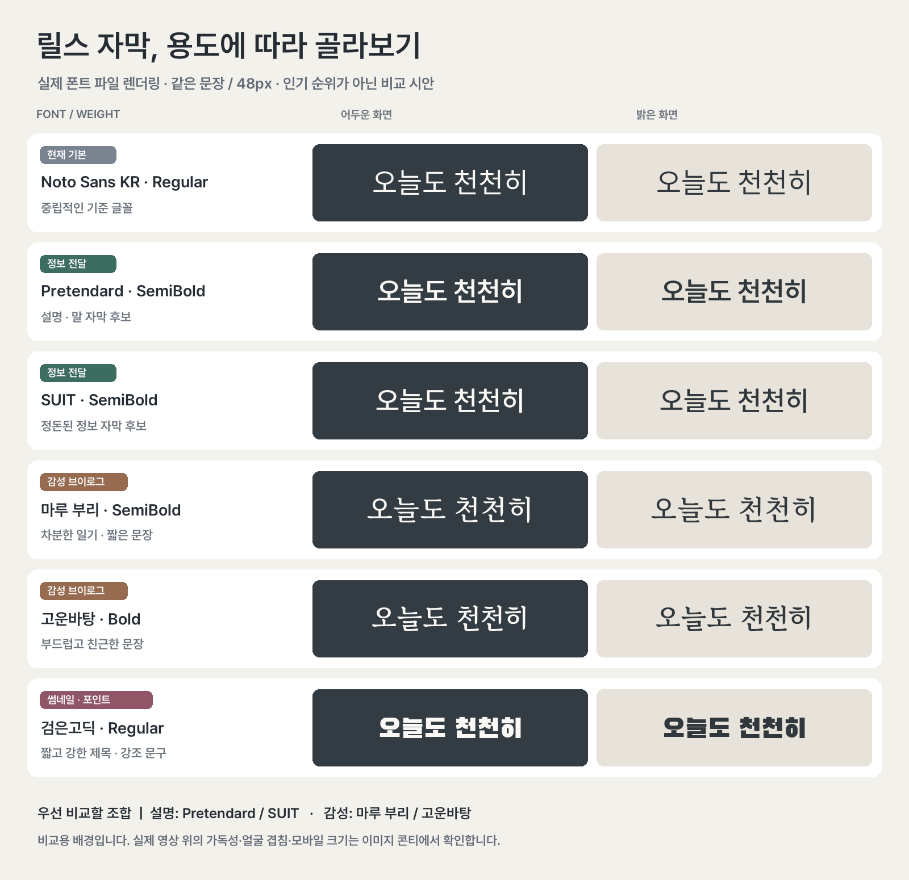

# 릴스 메이커 · reels-maker

아이폰 등으로 찍은 일상 영상을 Codex 또는 Claude Code와 함께 짧은 세로 영상으로 편집하는 스킬입니다. 타임로그·일상 모음·이야기형 릴스 중 형식을 먼저 고릅니다.

현재 버전: **v020.1** · [배포 기록](https://github.com/macro-ai-lab/reels-maker/releases)

**형식·선택적 레퍼런스 링크 → 영상별 최대 사용 길이 확인(기본 2초) → 타임로그일 때만 촬영시간 표시 여부 확인 → 영상 분석 → 사용자 맥락 입력 → 자막·그림 콘티 → 콘티 수정·확인 → 시안 제작** 순서로 진행합니다. 설치 명령과 편집 계획은 에이전트가 다루며, 사용자는 영상과 원하는 느낌을 말하면 됩니다.

## 설치

1. Mac 또는 Windows PC에서 파일·명령 실행을 지원하는 **Codex 또는 로컬 Claude Code**를 엽니다.
2. 새 작업 폴더를 선택하고 대화를 시작합니다. 이미 사용할 폴더가 있으면 그 폴더를 쓰면 됩니다.
3. 아래 주소와 요청문을 그대로 보냅니다.

사용자가 설치 파일을 직접 다운로드하거나 압축을 풀 필요는 없습니다. 운영체제 선택과 필요한 소스 다운로드는 에이전트가 맡고, 일반 설치 경로에는 Python·Git 사전 설치가 필요 없습니다.

> https://github.com/macro-ai-lab/reels-maker
>
> README와 INSTALLATION.md를 읽고 현재 작업 폴더에 릴스 메이커를 설치해줘. 내 실행 환경에 맞게 필요한 도구를 준비하고, 테스트 영상과 확인 이미지를 실제로 열어 사용 가능한지 점검해줘. 기존 스킬과 개인 지침은 보존해줘.

에이전트가 [설치 절차](INSTALLATION.md)에 따라 환경·허용 경로·기존 설치를 확인하고 맞는 설치기를 실행합니다. 프로젝트에 설치하면 편집 도구도 그 프로젝트 안에 준비하며, 이후에도 같은 프로젝트에서 사용합니다. 설치 과정에 필요한 접근 승인은 앱 안내에 따라 확인합니다.

공개 저장소의 소스를 받는 데 GitHub 계정은 필요 없습니다. Codex·Claude Code 설치·로그인과 이용 요금은 별개입니다. 버전별 배포 파일은 검증·복구 목적으로 릴리스에 보관하지만, 일반 설치 과정에서 사용자가 직접 다룰 필요는 없습니다.

Windows에서는 계정·폴더 소유자 이름만으로 설치를 막지 않고 실제 파일 작업 결과를 확인합니다. 기본 Windows HTTPS 다운로드가 실패하면 이미 설치된 실제 Python으로 인증서 검증을 유지해 재시도합니다. **기본 HTTPS도 실패하고 기존 Python도 없으면 현재 자동 설치를 완료할 수 없습니다.** 다운로드 해시 검증과 기존 설치·개인 지침 보호는 유지합니다. 사용자가 별도 CMD를 실행한 것을 자동 설치 성공으로 처리하지 않습니다.

설치는 **파일 배치 → 편집 도구 점검 → 테스트 영상 생성·읽기 → 에이전트 이미지 열람 확인**으로 구분해 보고합니다. 실행 도구 자체가 실패하거나 이미지 열람을 확인하지 못하면 전체 준비 완료라고 하지 않습니다. [검증 범위](INSTALLATION-VALIDATION.md)를 참고하세요.

준비되면 영상 파일을 첨부하거나 편집 컴퓨터의 파일/폴더 경로와 함께 요청합니다.

> 릴스 메이커로 이 영상들을 편집해줘. 영상 형식과 참고할 레퍼런스부터 정하고, 분석 후 콘티를 보여줘.

큰 영상은 채팅에 다시 올릴 필요 없이 로컬 경로로 전달할 수 있습니다. 휴대폰에만 있는 원본은 먼저 편집 컴퓨터로 옮겨야 합니다. 기존 수정본·다른 버전은 자동 덮어쓰지 않습니다.

## 이미지 콘티로 먼저 확인하기

먼저 **타임로그(시간순·행동 자막) / 일상 모음(순간·짧은 감상) / 이야기형 릴스(관점·전개·마무리)** 중 원하는 형식을 고릅니다. 잘 모르겠으면 “영상 보고 추천해줘”라고 할 수 있습니다. 처음에 참고하고 싶은 영상이 있는지도 물으며, 있으면 링크를 함께 받습니다. 링크가 없어도 진행하고 이미 받은 링크는 다시 묻지 않습니다. 그다음 영상별 최대 사용 길이(기본 제안 2초)를 확인하며, 촬영시간 표시 여부는 타임로그에서만 묻습니다. 일상 모음·이야기형은 시간 질문을 생략합니다. 사용자가 명시한 시간 설정은 유지합니다. 이미 정한 설정은 다시 묻지 않습니다. [형식별 기준과 실제 릴스 참고](reels-maker/references/formats.md)

### 분석 후 맥락 입력

설정이 정해지면 AI가 먼저 영상을 분석해 보이는 장면을 요약합니다. 그 뒤 **어떤 상황에서 찍었는지 / 무엇을 보여주고 싶은지 / 어떤 느낌과 말투로 만들고 싶은지**를 한 번의 편한 답변으로 받습니다. 이미 알려준 내용은 재사용하고 빠진 핵심만 묻습니다. 그 맥락을 받은 뒤 자막과 **이미지 생성으로 그린 콘티**를 만듭니다. 정해진 생각이 없으면 “그냥 일상 기록이야” 또는 “내용도 추천해줘”라고 답해도 됩니다. 새 맥락 질문에 답을 기다리는 동안 콘티를 먼저 만들지 않습니다.

### 자막과 그림 콘티

글 콘티부터 확인하고 싶다고 요청한 경우에는 그 순서를 따릅니다. 촬영·피드 콘티처럼 패널별 장면 그림, 컷 번호, 자막 자리와 효과 메모가 함께 나옵니다. “2번 설명을 위로”, “시간은 가운데 고정”, “첫 컷 제목만 크게”처럼 수정하고 확인한 의도로 영상 시안을 만듭니다. 실제 영상 프레임이나 최종 편집 계획은 그림 콘티 생성의 필수 입력이 아닙니다.

타임로그는 시간 흐름과 행동, 일상 모음은 느슨한 주제와 짧은 관찰·감상으로 연결합니다. 이야기형은 사용자 촬영 맥락과 실제 장면을 바탕으로 **이야기 한 줄 → 장면별 역할 → 연결되는 문장**을 정합니다. 그림 콘티에 이야기 방향과 각 컷의 기능을 함께 보여줘 말투·전개·마무리도 수정할 수 있습니다. 맥락이 이미 있으면 다시 묻지 않고, 내용 구성을 맡겼다면 장면에서 가능한 관점 하나를 추천합니다. 타임로그의 짧은 상황 설명부터 이야기형의 전달 의도까지 선택한 형식에 맞춰 반영하며, 여러 날짜를 한 하루처럼 꾸미거나 확인되지 않은 속마음·사건을 추가하지 않습니다. [이야기와 자막 안내](reels-maker/references/narrative.md)

이미지 생성은 현재 세션에 제공된 기능을 사용합니다. 로컬 스킬 설치가 이미지 생성 서비스를 추가하지는 않으며, 해당 기능이 없는 세션에서는 콘티 이미지 생성이 미완료임을 알립니다.

개발 소스의 이야기형 기본 지침은 **흰색 Pretendard 본문 · 노란 기울임 마루 부리 리액션 · 분홍빛 제목/마무리 · 작은 SUIT 촬영시간**으로 자막 역할을 나눕니다. 타임로그와 일상 모음은 담백한 본문·시간 중심으로 적용하고 강한 리액션·글로우를 강요하지 않습니다. 번들 폰트와 라이선스를 사용하며 기존 작품·개인 지침이 우선합니다. [기본 편집 지침](reels-maker/references/default-editing.md) · [글꼴·배치 안내](reels-maker/references/typography.md) · [이미지 콘티 안내](reels-maker/references/visual-storyboard.md)

그림 콘티는 장면·배치·효과 의도 확인용입니다. 정확한 폰트 모양과 크기, 움직임·전환·음악은 실제 영상 시안에서 확인합니다. 실제 프레임 스타일 미리보기는 필요할 때만 사용하는 선택 도구이며 그림 콘티를 대체하지 않습니다. 현재 기본 render 명령은 자막 애니메이션·두 줄 설명·반투명 자막 박스를 지원하지 않습니다. 기울임·글로우·팝·전환·원음은 에이전트가 작업별 별도 합성의 지원 여부와 실제 결과를 확인합니다. 기본 지침을 추가한 것을 렌더러 자동 기능 추가로 표시하지 않습니다.

## 현재 편집 기능

- 영상별 최대 사용 길이를 먼저 정합니다(기본 제안 2초). 선택한 상한 안에서 핵심 구간을 고르고, 짧은 원본은 늘리지 않습니다. 타임로그 요청이면 촬영 순서를 따릅니다.
- 긴 영상은 간격별로 훑은 뒤 후보 구간을 자세히 확인합니다. 샘플 사이의 짧은 행동은 빠질 수 있습니다.
- 타임로그에서만 시작에 시간 자막을 넣을지 묻습니다. 다른 형식은 묻지 않고 미지정이면 시간 자막을 생략합니다. 사용자가 직접 지정한 설정은 우선합니다. 켠 경우에도 실제 촬영시각이 확인된 컷에만 표시하며, 끈 경우 콘티와 영상에서 모두 생략합니다.
- 새 작업은 선택한 형식에 맞는 자막·강조를 사용합니다. 기존 Noto Sans KR 중앙 타임로그 계획과 렌더러의 호환 기본값은 유지하며, 새 계획에는 실제 역할별 폰트를 명시합니다.
- 제목·시간·문장 위치와 폰트·크기를 말로 수정할 수 있습니다. 반복할 선호는 변경안을 확인받은 뒤 스킬 밖의 개인 지침으로 저장하고, 이번 요청 > 개인 지침 > 배포 기본값 순서로 적용합니다.
- 1080×1920, 24fps, H.264 MP4 출력. 현재 기본 렌더 범위는 4~20컷·총 10~40초이며 이보다 짧은 구성은 범위 조정이 필요합니다. 길이를 맞추려고 장면을 반복하지 않습니다.
- 최종 원음은 기본으로 유지합니다. 사용 범위가 확인된 별도 음악 파일을 선택할 수 있으며, BGM이 없어도 원음은 남깁니다. 원본에 소리가 없거나 사용자가 요청한 경우에 무음으로 만듭니다. 음악 자동 검색 기능은 없습니다.

## 지원 환경과 검증 범위

| 환경 | 상태 |
| --- | --- |
| macOS 14 이상 · Apple Silicon | 같은 Mac의 빈 전용 캐시에서 두 클라이언트 경로의 자동 설치·영상 읽기 검증. 이전 배포의 10초 렌더 검증 |
| Intel Mac | 코드 경로 제공, 실제 장치 검증 전 |
| Windows 10/11 x64 | 사용자 전달 수정 소스 시험에서 샌드박스 계정 설치·빈 캐시 준비·테스트 영상 읽기 성공. 기존 Python 대체 다운로드 사용. 최종 v020 ZIP의 설치·도구 검사는 아래 CI 결과와 구분하고 실제 에이전트 세션 재시험은 별도 |
| Windows ARM/32비트 · Linux | 미지원 |
| 아이폰·아이패드 단독 실행 | 미지원. 편집할 Mac/PC 필요 |

현재 기본 편집 입력은 **무음 H.264 SDR MP4**입니다. 휴대폰 영상의 HEVC/HDR·회전 정보·원음이 있으면 먼저 확인하고 처리 방법을 정합니다. 임의로 소리를 제거하거나 원본을 덮어쓰지 않습니다. 모든 휴대폰 형식을 바로 편집할 수 있다는 뜻은 아닙니다.

같은 Mac에서 격리 설치한 시험은 새 컴퓨터·새 운영체제나 실제 초보자 사용 시험을 대신하지 않습니다. 다운로드 보안 경고·조직 정책이 나타나면 에이전트에게 알려주세요. 보안 기능을 끌 필요는 없습니다.

## 포함 파일

- `reels-maker/SKILL.md`: 단계별 제작과 확인 절차
- `reels-maker/scripts/`: 환경 준비·분석·편집 코드
- `reels-maker/runtime/`: 고정한 모듈 버전과 다운로드 해시
- `reels-maker/references/`: 편집 계획·기본 스타일·지원 범위
- `reels-maker/assets/fonts/`: 역할별 번들 폰트와 기존 호환용 Noto Sans KR·각 라이선스
- 루트의 설치기와 `시작하기.txt`

개인 영상, 완성 영상, 계정 인증 정보, 설치된 Python과 도구 캐시는 포함하지 않습니다. 예제 스톡 영상과 음악도 별도로 준비해야 합니다. 원본 영상과 개인 자료는 저장소 밖에 보관하세요.

폰트 저작권과 이용 조건은 [Noto Sans KR 라이선스](reels-maker/assets/fonts/NotoSansKR-LICENSE.txt)와 [Pretendard 라이선스](reels-maker/assets/fonts/LICENSE.txt)를 참고하세요. 이 폰트는 시스템에 설치하지 않고 파일로 사용합니다.

## 지원 클라이언트

자동 설치 대상은 **Codex와 로컬 Claude Code**입니다. 같은 설치 요청을 보내면 에이전트가 자기 클라이언트·운영체제·폴더 권한에 맞는 설치기를 실행합니다. 프로젝트 설치는 Codex의 `.agents/skills`, Claude Code의 `.claude/skills`로 나뉩니다. 사용자 범위는 각각 `CODEX_HOME/skills`(기본 `~/.codex/skills`), `CLAUDE_CONFIG_DIR/skills`(기본 `~/.claude/skills`)입니다. 클라이언트 설정 폴더를 직접 지정했다면 절대경로를 사용합니다.

설치 기록으로 다음 실행에서도 클라이언트와 범위를 찾습니다. 개인 지침은 각 클라이언트의 설정 폴더 안, 스킬 폴더 밖에 따로 보존합니다. 다른 클라이언트의 개인 지침을 자동으로 가져오거나 설정 파일·전역 PATH를 바꾸지 않습니다.

일반 Claude 채팅·Cowork는 이번 자동 설치 대상에 포함하지 않습니다. [환경별 점검 결과](COMPATIBILITY.md)에서 자동 설치 코드 검증과 실제 클라이언트 실행 검증을 구분해 확인하세요. 실제 Claude Code의 스킬 탐색·호출, 새 채팅·다른 계정 및 네이버 실계정 작업은 별도 검증 대상입니다. ZIP의 OS별 설치와 선택적인 실제 프레임 미리보기·렌더 검사는 GitHub Actions 결과로 확인합니다. 이미지 생성 도구의 가용성과 생성 품질은 이 자동 검사와 별개입니다.

근거: [Claude Code 스킬 설치 범위](https://code.claude.com/docs/en/skills), [Claude Code 설정 폴더](https://code.claude.com/docs/en/claude-directory).

## 설치기 유지보수

두 프로젝트는 같은 [설치·배포 스킬](_maintenance/skill-distribution/SKILL.md)과 템플릿을 사용합니다. 새 기능을 배포할 때도 네 경우의 설치와 최종 ZIP을 검사합니다. 사용자는 이 관리 스킬을 별도로 설치할 필요가 없습니다. [GitHub 설치 검사](https://github.com/macro-ai-lab/reels-maker/actions/workflows/installation.yml)는 macOS·Windows 네이티브에서 Codex·Claude Code용 경로의 프로젝트/사용자 설치를 검사합니다. 실제 에이전트 세션의 스킬 인식·이미지 열람·계정 작업 검증과는 구분합니다.

## 이름 변경과 레퍼런스

이전 `daily-vlog`에서 `reels-maker`(릴스 메이커)로 이름을 바꿨습니다. 새 호출은 Codex `$reels-maker`, Claude Code `/reels-maker`입니다. 기존 사용자 설치·수정본을 자동 덮어쓰지 않으며, 개인 지침·도구 캐시·기존 작품 기록은 [호환 안내](reels-maker/references/renaming.md)에 따라 유지합니다.

레퍼런스 링크는 구성·자막·리듬을 참고하기 위한 선택 입력입니다. 인스타 로그인·재생 제한으로 확인하지 못한 경우에는 미확인으로 알리고 사용자 설명이나 접근 가능한 자료로 진행합니다. 링크 접수와 실제 영상 확인을 구분하며 쿠키를 자동 수집하지 않습니다. [레퍼런스 처리](reels-maker/references/reference-video.md)
